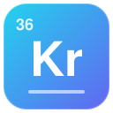

<div align="center">



# Krypton Hybrid

**Leaner, faster Minecraft networking: negotiated Zstd compression, compact chunk and entity traffic, one flush per tick, and an opt-in security layer.**

[](https://www.curseforge.com/minecraft/mc-mods/krypton-hybrid)
[](#supported-versions)
[](#supported-versions)
[](#supported-versions)
[](LICENSE)

[](https://www.curseforge.com/minecraft/mc-mods/krypton-hybrid)
[](https://github.com/dreamforSh/KryptonHybrid)

[Highlights](#highlights) &nbsp;·&nbsp; [Installation](#installation) &nbsp;·&nbsp; [How it works](#how-it-works) &nbsp;·&nbsp; [Commands](#commands) &nbsp;·&nbsp; [Security](#network-security) &nbsp;·&nbsp; [Changelog](CHANGELOG.en.md) &nbsp;·&nbsp; [更新日志](CHANGELOG.md)

</div>

<a name="overview"></a>
##  Overview

Krypton Hybrid optimizes the network stack of Minecraft servers and clients. It started as a fork of the legacy (1.19.2) [Krypton FNP](https://github.com/404Setup/KryptonFNP), completes the optimizations its lite version left out, and keeps the features of Krypton FNP and RecastLib. On top of that it replaces vanilla zlib with Zstd negotiated per connection, re-encodes chunk, light and entity traffic, sends each player's packets with one flush per tick, and adds a security layer for public servers. It is compatible with hybrid servers.

<a name="highlights"></a>
##  Highlights

<table>
  <tr>
    <td width="50%" valign="top">
       <b>Zstd compression</b><br>
      Negotiated per connection during login, with an optional trained dictionary and batch frames. Vanilla clients and proxies keep zlib.
    </td>
    <td width="50%" valign="top">
       <b>Compact chunks and light</b><br>
      Byte-aligned block data, client-computed heightmaps, a compact biome stream and one-byte uniform light layers.
    </td>
  </tr>
  <tr>
    <td valign="top">
       <b>Delayed chunk cache</b><br>
      Chunks you walk away from stay on your client for a while; coming back skips the resend when nothing changed.
    </td>
    <td valign="top">
       <b>Tick batching</b><br>
      One flush per player per tick, coalescing of superseded entity packets, a motion filter and bundles.
    </td>
  </tr>
  <tr>
    <td valign="top">
       <b>Hot-path optimizations</b><br>
      Faster VarInts and strings, Velocity-style framing, native ciphers on both sides, cached broadcast encodings.
    </td>
    <td valign="top">
       <b>Security layer (opt-in)</b><br>
      Per-IP rate limits, stage-aware timeouts, size and decompression guards, slow-reader protection.
    </td>
  </tr>
  <tr>
    <td valign="top">
       <b>Stats dashboard and HUD</b><br>
      Live bandwidth and saving, per-mod traffic, flush and cache statistics, security counters.
    </td>
    <td valign="top">
       <b>Visual config editor</b><br>
      Edit client and common settings in game; server owners can edit a dedicated server's config remotely.
    </td>
  </tr>
</table>

<a name="supported-versions"></a>
##  Supported versions

| Branch | Minecraft | Loader | Java |
|---|---|---|---|
| `main` (this README) | 1.21.1 | NeoForge 21.1 | 21 |
| `1.20.1` | 1.20.1 | Forge 47 | 17 |
| `1.19.2` | 1.19.2 | Forge 43 | 17 |

<a name="installation"></a>
##  Installation

Drop the jar into the `mods` folder. Installing it on both the server and the clients gives the full benefit, but either side works on its own:

| Installed on | What you get |
|---|---|
| Server and client | Zstd (when both choose it), compact chunk and light formats, block entity deltas, batch frames (when enabled) |
| Server only | Other clients join normally with zlib and vanilla formats; flush consolidation, coalescing, caches and the security layer still apply |
| Client only | Works with any server over zlib; native encryption and the client-side optimizations still apply |

Settings live in `config/krypton_hybrid-common.toml` (server and shared) and `config/krypton_hybrid-client.toml` (dashboard and HUD), and can be edited in game with the mod list's **Config** button. Behind a proxy (Velocity, BungeeCord), set `proxy.mode = VELOCITY`.

<a name="how-it-works"></a>
##  How it works

###  Compression pipeline

Krypton Hybrid replaces Minecraft's default zlib codec by injecting into `Connection.setupCompression`.

| Feature | Detail |
|---|---|
| Primary algorithm | Zstd via `zstd-jni` (native) |
| Fallback algorithm | zlib via `velocity-native` |
| Level range | 1 – 22 (default 3) |
| Multi-threaded | `workers` ≥ 1 activates the native thread pool |
| Dictionary | Optional pre-trained `.zdict`, used for packets up to `dict_max_packet_bytes` (larger ones are compressed without it). Load failures are logged; with `dict_required` Zstd is not offered (zlib), otherwise plain Zstd is used. See the [Zstd dictionary training guide](docs/zstd-dictionary-training.md). |
| Advanced tuning | `overlap_log`, `job_size`, `strategy`, `LDM` + `window_log` |
| Batch frames | Optional (`batch_frames.enabled`, off by default): the server sends all packets of one flush to a Krypton Hybrid client as one Zstd frame |

**Negotiation.** The algorithm is negotiated per connection during login, with a vanilla login custom query that the server sends right before the compression packet (NeoForge negotiates its channels only later, in the configuration phase, after compression is already on). Both sides offer a token naming Zstd, the dictionary ID and batch-frame support; Zstd is used only when the tokens match. A vanilla client answers that it does not know the query, and behind a proxy (`proxy.mode` other than `NONE`) the server does not ask, so those connections use vanilla zlib.

**Batch frames.** Without batching every packet is its own frame, and packets below the compression threshold (256 bytes by default; entity movement, block updates, ...) are sent uncompressed. With `batch_frames.enabled` the server holds the packets written between two flushes and compresses them together into one frame; the client splits it back into single packets before vanilla's packet decoder, so the rest of the pipeline and other mods still see one packet at a time, in order. With `tick_flush` that is one frame per player per tick.

- Server to client only, and only to clients that agreed during login (Krypton Hybrid with Zstd, same dictionary, no proxy).
- A packet flushed on its own, a packet above `max_packet_bytes`, and chunk / light packets at or above the threshold (served by the compressed broadcast cache) leave as single frames, after the packets held before them.
- A batch is capped at `max_batch_bytes` uncompressed; if compressing it would not beat sending its packets as single frames, they are sent as single frames.
- `/krypton stats` shows how many batch frames were sent and how many packets they carried.

###  Light payload: uniform layers

Sky-light sections above the surface are almost always uniform (`0xFF`, all 15). Instead of writing 2 048 bytes per uniform layer, Krypton encodes it in 2 bytes. It only activates when `2048 × uniform_count + raw_count − 1 > 0`, and saves up to about 40 KB per chunk in open-sky areas (view distance 12, up to 20 uniform sky layers).

<details>
<summary>Wire format (<code>ClientboundLightUpdatePacketData</code>)</summary>

```
[0x4B]            – Krypton marker (1 byte)
[skyYMask]        – BitSet
[blockYMask]      – BitSet
[emptySkyYMask]   – BitSet
[emptyBlockYMask] – BitSet
[skyCount]        – VarInt
For each sky DataLayer:
  [0x01] + 1 byte     – uniform (all nibbles == byte)
  [0x00] + 2048 bytes – raw    (fixed size, no VarInt prefix)
[blockCount]      – VarInt
For each block DataLayer: same as above
```

</details>

###  Chunk data

| Optimization | Mechanism | Benefit |
|---|---|---|
| XOR-delta heightmaps | Adjacent columns correlate → many near-zero longs | Better Zstd/zlib ratio, ~40 B of NBT overhead removed |
| Biome stream split | Biome data grouped; single-value sections compacted | Single-value: 2 B instead of 3+ B; redundancy across sections exploited |
| Byte-aligned block data (`0x4C`) | 5–8-bit sections: one byte per palette index instead of bit-packed longs; 4-bit sections: little-endian longs | Indices no longer straddle bytes, so the compressor finds repeated patterns |
| Client-computed heightmaps | The server sends no heightmaps; the client computes `WORLD_SURFACE` and `MOTION_BLOCKING` from the blocks | Heightmap bytes removed from every chunk packet |

**Byte-aligned block data.** Vanilla packs block-state palette indices into longs; indices wider than 4 bits straddle byte boundaries, so the same block pattern becomes different bytes depending on where it starts. For clients that advertise it (`FEATURE_CHUNK_ALIGNED_BLOCKS` in the hello), the server rewrites each section's block data: 5–8-bit sections as 4 096 raw index bytes, 4-bit sections as little-endian longs; single-value and global-palette sections are unchanged. The client restores vanilla longs before `LevelChunkSection.read()`. On a test world (973 overworld chunks) chunk packets got 7.5 % smaller after Zstd level 6 (6.8 % with zlib) for about 0.04 ms of extra work per chunk on each side. Older clients keep receiving `0x4B`.

**Client-computed heightmaps.** The client's `WORLD_SURFACE` and `MOTION_BLOCKING` heightmaps follow from the block data, so for clients that advertise `FEATURE_CHUNK_CLIENT_HEIGHTMAPS` the server sends an empty heightmap list. The client scans each column top-down with the heightmaps' own block predicates and hands the result to vanilla in its raw format. On the test world the computed `WORLD_SURFACE` matched the server's saved heightmap in all 973 chunks, took about 0.08 ms per chunk, and chunk packets got another 6.6 % smaller.

<details>
<summary>Wire format (<code>ClientboundLevelChunkPacketData</code>)</summary>

```
[0x4B]            – Krypton chunk-data marker (1 byte); 0x4C = byte-aligned block data

──── Heightmaps (binary + XOR-delta) ────
VarInt  entry_count               (0 = client computes them)
Per entry:
  UTF-8  key
  VarInt long_count
  long[] XOR-delta encoded  (delta[i] = raw[i] ^ raw[i-1])

──── Block data (sections without biomes) ────
VarInt  blocks_length
byte[]  blocks  (short nonEmptyCount + PalettedContainer<BlockState> per section)

──── Biome data (compact stream) ────
VarInt  section_count
Per section:
  0x01 + VarInt(biomeId)          – single-value section (2 bytes vs. 3+)
  0x00 + VarInt(len) + raw bytes  – multi-value section

──── Block entities ────
LIST_STREAM_CODEC (unchanged vanilla encoding)
```

</details>

###  Delayed chunk cache (DCC)

Departing chunks the client actually received (recorded when `PlayerChunkSender` sends or forgets them) are **kept on the client** instead of being dropped at once, as long as they stay within the client's chunk storage (view distance + 3 around its view center). State is tracked per connection; when the player disconnects, changes dimension or respawns, nothing is kept. If the player comes back before the entry expires **and the chunk has not changed since it left the player's view**, the full resend is skipped. Every chunk carries a change stamp, bumped on block, block-entity, light and biome changes even when nobody else watches the chunk; a changed chunk is resent normally.

| Config key | Default | Description |
|---|---|---|
| `dcc.enabled` | `true` | Master switch |
| `dcc.size_limit` | 60 | Max kept chunks per player |
| `dcc.timeout_seconds` | 30 | Forced eviction timeout |

Kept chunks are evicted by **distance** (before the player's view center moves, so the client still applies the forget), **capacity** and **timeout** (on `ChunkMap.tick()`).

###  Flush consolidation and tick batching

Each server tick's packets are written to every player's connection and flushed once, instead of one flush per packet. With `tick_flush.enabled` (default) the hold covers the **whole server tick** (world, entity, block-entity and player ticks), and each connection is released by vanilla's own per-connection flush in the connection phase. Replies to client packets between ticks are not held. Inside the tick, the broadcast phase still collects and coalesces packets per player:

```
MinecraftServer.tickServer() HEAD
  Hold flushes for all players (whole-tick window)

ServerChunkCache.tickChunks() "broadcast" phase
  ① Recovery: deliver anything a failed previous tick left behind
  ② Hold flushes for all players (outermost window)
  ③ Collect block / light / block-entity updates per player

ChunkMap.tick() (entity tracking, right after tickChunks, still inside the window)
  ④ Write the collected block updates first (vanilla order)
  ⑤ Collect entity updates per player, coalesce them, write them

ServerChunkCache.tick(), after ChunkMap.tick()
  ⑥ Without tick_flush: release the hold → one flush per player (or after micro_batch_flush.delay_ms)

Connection.tick() (connection phase)
  ⑦ With tick_flush: release this player's hold → one flush for the whole tick
```

Window state changes reach each connection's event loop as tasks queued behind the writes, so packets sent from the server thread are batched even when their writes run after the window closes. Chunk batches sent by `PlayerChunkSender` and the packets of `ServerEntity.addPairing` only hold the flush themselves when no window already does.

| Layer | Mechanism | Benefit |
|---|---|---|
| Flush consolidation (Netty) | Buffer writes, one `flush()` per player per tick | Fewer syscalls on busy servers |
| Packet coalescing | Drop superseded motion / teleport / entity-data / head-rotation packets in the same tick | Fewer packets and bytes |
| Motion delta filter | Drop velocity packets that barely changed since the last one sent to that player (a stop is always sent) | Fewer projectile and item packets |
| Bundles (protocol) | A player's packets of one tick → `ClientboundBundlePacket`s of at most 4096 packets; with `bundle_compression`, sub-packets are compressed from `min_bytes` up | The client applies the tick's updates together; small sub-packets compressed |

The dashboard reports **flush savings** (share of flushes avoided, `1 − flushes / packets held`) and **packets per flush**.

###  Hot-path micro-optimizations

| Target | Optimization |
|---|---|
| `VarInt.read()` | Branchless 4-byte `getIntLE` + bit-twiddling fast path |
| `VarInt.getByteSize()` | Lookup table via `Integer.numberOfLeadingZeros` |
| `VarLong.getByteSize()` | Same lookup-table approach |
| `FriendlyByteBuf.writeVarInt()` | Peeled 1/2/3/4/5-byte paths, writes directly to the backing `ByteBuf` |
| `FriendlyByteBuf.writeUtf()` | Single pass via `ByteBufUtil.utf8Bytes`, no intermediate `byte[]` |
| `Varint21FrameDecoder` | Velocity-derived framing + null-ping attack mitigation |
| `Varint21LengthFieldPrepender` | Writes the frame length into room the compressors reserve, no copy of the frame |
| Encryption | Native in-place AES on the server and the client |

<a name="commands"></a>
##  Commands

```
/krypton stats show           – compression ratio, bandwidth saving, flushes, batch frames, caches
/krypton stats gui            – open the stats dashboard
/krypton stats reset          – reset all counters
/krypton packets bycount [n]  – top N packet types by count
/krypton packets bybytes [n]  – top N packet types by bytes
/krypton packets bywire [n]   – top N packet types by bytes on the wire
/krypton mods bycount [n]     – top N mod namespaces by count
/krypton mods bybytes [n]     – top N mod namespaces by bytes
/krypton mods bywire [n]      – top N mod namespaces by bytes on the wire
/krypton security status      – security metrics (rate limits, validation, anomalies, ...)
/krypton zstd status          – compression, dictionary and sample capture status
/krypton zstd dict reload     – reload the Zstd dictionary
```

The commands require operator permission level 2. Editing the server's config from the in-game config screen requires level 4 and a dedicated server; options naming files or directories, and sample capture, are read-only there.

<a name="dashboard"></a>
##  Dashboard and HUD

Press <kbd>K</kbd> (rebindable) or run `/krypton stats gui` to open the dashboard: a translucent panel with **Overview**, **Traffic**, **Mods** and **Security** tabs (number keys 1–4), live charts, the compression this connection negotiated, and dark and light themes. The HUD (toggle key unbound by default) shows live rates with sparklines, latency and the top mod, in any corner. Both remember their settings in `krypton_hybrid-client.toml`.

<a name="network-security"></a>
##  Network security

Krypton Hybrid includes a configurable security layer injected into the Netty pipeline. Everything sits behind `security.enabled`, **off by default**, and is tuned in the `[security]` section of `krypton_hybrid-common.toml`. Tune the per-IP limits and timeouts for your network (proxies, tunnels, shared NAT addresses) before turning it on. Optimizations such as the broadcast serialization cache and the MOTD cache do not depend on this switch.

```
[Socket]
  → krypton_rate_limiter      Per-IP connection rate limiter
  → krypton_timeout           Stage-aware read timeout (HANDSHAKE → LOGIN → PLAY)
  → timeout (vanilla)
  → legacy_query (vanilla)
  → splitter (Varint21)
  → krypton_size_validator    Frame size validation
  → decoder
  → prepender
  → encoder
  → krypton_resource_guard    Write watermarks + slow-reader protection
  → packet_handler (Connection)
```

| Module | Description |
|---|---|
| **Connection rate limiter** | Per-IP token bucket (8/s sustained, burst 20) with a rapid-reconnect penalty and a 30 s quarantine. IPv6 sources are grouped by /64; loopback and proxied connections are not limited. |
| **Handshake timeout** | Stage-aware read timeout: HANDSHAKE 5 s → LOGIN 30 s → PLAY 30 s, plus an absolute handshake deadline of twice `handshake_sec` against slow-drip connections. |
| **Status ping guard** | Per-IP status ping limit (4/s, burst 8), legacy `0xFE` ping guard, and a 3 s MOTD cache. |
| **Packet size validator** | Frame size check (default 2 MiB); closes connections sending frames far above the limit. |
| **Handshake validator** | Server address length/content and port range checks; rejects scanners and malformed clients early. |
| **Decompression bomb guard** | Server-side limits on the declared size (16 MiB) and the ratio (100:1) of compressed client packets. |
| **Inbound read limits** | Opt-in (`read_limits_enabled`): hard caps on strings, byte arrays, collections and maps in packets the server receives. |
| **Anomaly detector** | Per-connection weighted strikes; disconnects at 10 strikes. Currently fed by handshake validation failures. |
| **Netty resource guard** | Write watermarks (512 KiB / 2 MiB); closes a connection with more than 4096 pending writes that has been unwritable for 15 s. |
| **Security metrics** | Lock-free counters for every security event, shown by `/krypton security status` and the dashboard. |

<details>
<summary>Configuration (<code>[security]</code> section)</summary>

```toml
[security]
  enabled = false                           # Global switch (off by default)

  [security.connection_rate_limit]
    rate = 8                                # Per-IP sustained connections/s
    burst = 20                              # Per-IP burst limit
    quarantine_seconds = 30

  [security.decompression_guard]            # Checked by the server on client packets only
    max_decompressed_bytes = 16777216
    max_ratio = 100

  [security.timeouts]
    handshake_sec = 5                       # The handshake also ends after 2 × this at the latest
    login_sec = 30                          # Mojang auth + compression negotiation (vanilla: 30s)
    play_sec = 30

  [security.packet_size]
    frame_max_bytes = 2097152               # 2 MiB max frame
    read_limits_enabled = false             # Hard caps on serverbound reads

  [security.status_ping_guard]
    enabled = true
    rate = 4
    burst = 8

  [security.handshake_validation]
    max_address_length = 255

  [security.anomaly]
    strike_threshold = 10                   # Weighted strikes before disconnect

  [security.resource_guard]
    watermark_low = 524288                  # 512 KiB (capped at watermark_high)
    watermark_high = 2097152                # 2 MiB
    max_pending_writes = 4096
    max_unwritable_seconds = 15
```

</details>

<a name="benchmarks"></a>
##  Benchmarks

In the original test, the mod reduced the initial login traffic to 13 % of its vanilla size.


<a name="changelog"></a>
##  Changelog

See [CHANGELOG.en.md](CHANGELOG.en.md) (English) or [CHANGELOG.md](CHANGELOG.md) (简体中文).

<a name="credits"></a>
##  Credits

- [Krypton Fabric](https://modrinth.com/mod/krypton)
- [Krypton FNP](https://github.com/404Setup/KryptonFNP)
- [Velocity](https://github.com/PaperMC/Velocity)
- [VelocityNT Recast](https://github.com/404Setup/VelocityNT-Recast)
- [Paper](https://github.com/PaperMC/Paper)
- [RecastSSL](https://github.com/404Setup/RecastSSL)
- [NotEnoughBandwidth](https://github.com/USS-Shenzhou/NotEnoughBandwidth)

<a name="license"></a>
##  License

Krypton Hybrid is licensed under the [GNU LGPL 3.0](LICENSE).
